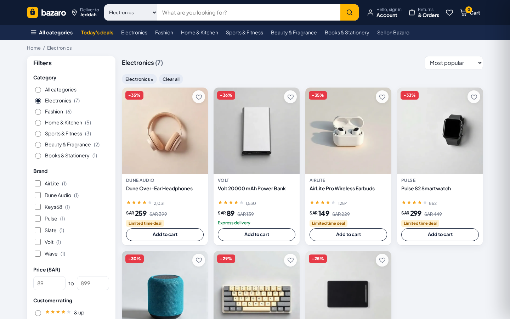
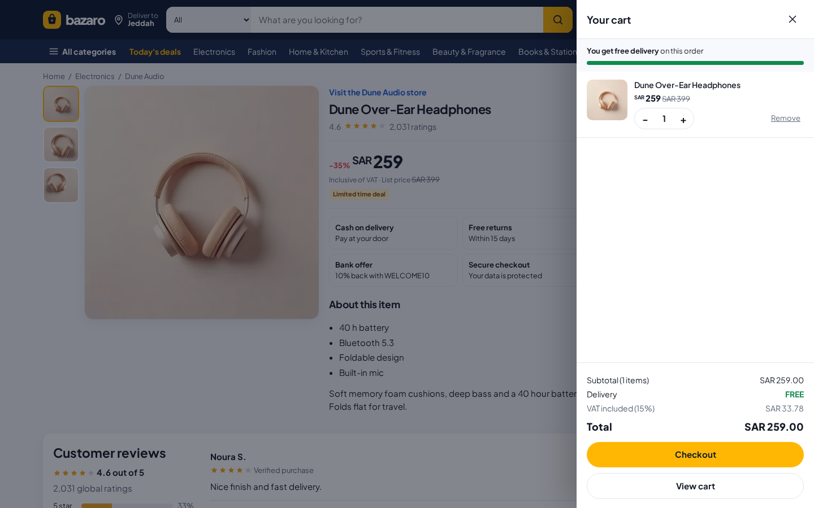
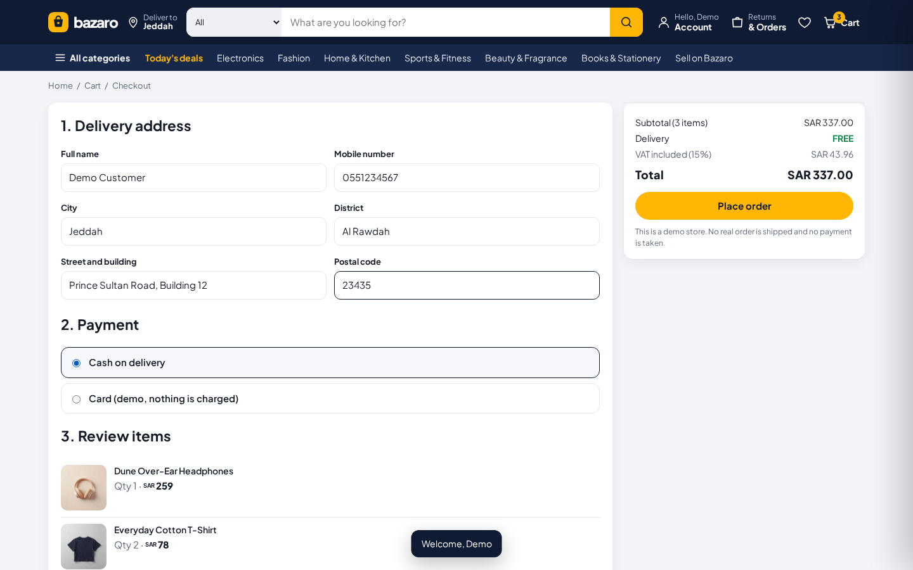
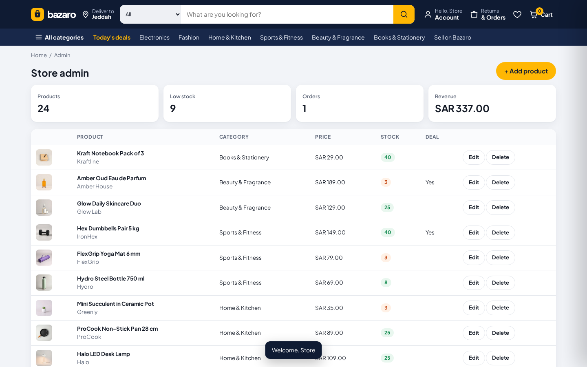
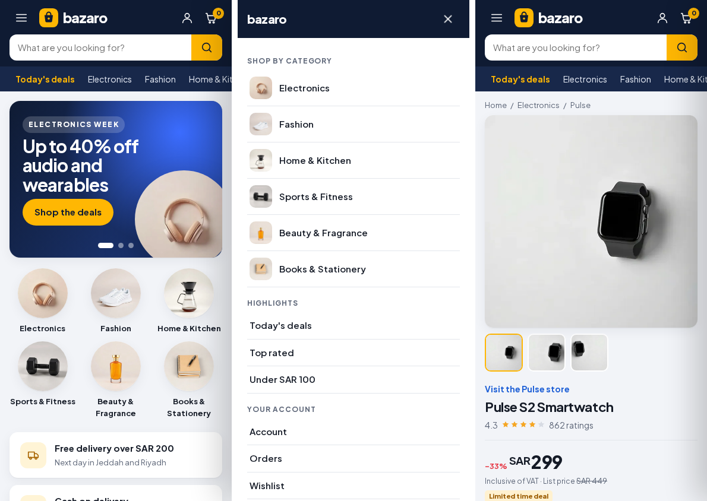

# Bazaro: full stack online marketplace

A marketplace web app in the style of the big online stores, built with **Node.js, Express and SQLite**. Shoppers can search and filter products, open a product page with a gallery, use a slide-out cart, save a wishlist, sign up, check out and see their order history. Store admins get a panel to add, edit and delete products and see orders and revenue.

**Live demo:** https://mohammadgulab.github.io/bazaro-marketplace/

> The live demo runs on GitHub Pages, which cannot run Node.js. There the storefront switches to a small in-browser copy of the same REST API and keeps data in `localStorage`. Clone the repo and run `npm start` to use the real Express API and SQLite database.


| Search and filters | Product page and cart drawer |
| --- | --- |
|  |  |

| Checkout | Admin panel |
| --- | --- |
|  |  |

**On a phone** (home, full screen menu, product page)



## Features

**Storefront**
- Header with category search, live search suggestions (arrow keys work) and a category mega menu
- Home page with an auto playing deals carousel, category tiles, "Deals of the day" with a countdown, product rails and grids
- Product listing with filters for category, brand, price range, rating, deals and stock, six sort options, filter chips and paging
- Product page with image gallery and hover zoom, discount and VAT info, delivery date, stock status, quantity, buy now, reviews with rating bars and related products
- Slide-out cart drawer with quantity controls, free delivery progress bar and VAT breakdown
- Sign up and sign in, wishlist, checkout with Saudi phone and postal code checks, order confirmation with a tracker, order history
- Premium look: Gold membership strip, product badges (Best seller, Limited, Premium), live deal countdown, luxury banners, brand row, trust badges, skeleton loaders and scroll animations
- Responsive from 360 px phones to wide desktops, full screen mobile menu and filter sheet, reduced motion support

**API and backend**
- REST API with Express and SQLite (better-sqlite3), foreign keys and indexes
- JWT login with passwords hashed by bcrypt, customer and admin roles
- Checkout runs in a database transaction: prices and stock are read from the database, never trusted from the browser, and stock is reduced per order
- Server side cart for signed in shoppers, merged with the guest cart on sign in
- Input validation with zod and clear field errors, one central error handler, JSON 404s
- Admin endpoints for products, stats and orders
- 39 Jest and supertest tests

## Tech stack

| Part | Tools |
| --- | --- |
| Backend | Node.js 18+, Express 4 |
| Database | SQLite with better-sqlite3 |
| Auth | JSON Web Tokens (jsonwebtoken), bcryptjs |
| Validation | zod |
| Frontend | HTML, CSS (grid, flexbox, custom properties), vanilla JavaScript, hash routing, no build step |
| Tests | Jest, supertest |
| Hosting of the demo | GitHub Pages (static mode) |

## Getting started

```bash
git clone https://github.com/mohammadgulab/bazaro-marketplace.git
cd bazaro-marketplace
npm install
cp .env.example .env
npm run seed      # loads 24 products, an admin and a demo customer
npm start         # http://localhost:3000
```

Run the tests:

```bash
npm test
```

Demo accounts (made by the seed script):

| Role | Email | Password |
| --- | --- | --- |
| Customer | demo@bazaro.test | demo1234 |
| Admin | admin@bazaro.test | admin123 |

## Environment variables

| Name | Default | What it does |
| --- | --- | --- |
| `PORT` | `3000` | Port the server listens on |
| `DB_FILE` | `./data/bazaro.db` | Path of the SQLite file |
| `JWT_SECRET` | dev value | Secret used to sign login tokens, change it in production |
| `JWT_EXPIRES_IN` | `7d` | How long a login stays valid |
| `ADMIN_EMAIL` | `admin@bazaro.test` | Admin account made by the seed script |
| `ADMIN_PASSWORD` | `admin123` | Password for that admin |

## API endpoints

All responses are JSON. Routes marked with a lock need `Authorization: Bearer <token>`.

| Method | Path | Description |
| --- | --- | --- |
| GET | `/api/health` | Health check |
| GET | `/api/config` | Shop rules: free delivery limit, delivery fee, VAT rate |
| GET | `/api/categories` | Categories with product counts |
| GET | `/api/products` | List products. Query: `q`, `category`, `brand` (comma list), `minPrice`, `maxPrice`, `rating`, `deal`, `inStock`, `sort` (popular, price_asc, price_desc, rating, newest, discount), `page`, `limit`. Returns data, paging and facets |
| GET | `/api/products/suggest?q=` | Up to 6 search suggestions |
| GET | `/api/products/:slug` | One product with reviews and related products |
| POST | `/api/auth/register` | Create an account, returns a token |
| POST | `/api/auth/login` | Sign in, returns a token |
| GET | `/api/auth/me` | The signed in user (lock) |
| GET | `/api/cart` | Saved cart with totals (lock) |
| PUT | `/api/cart` | Replace the saved cart: `{ items: [{ productId, qty }] }` (lock) |
| GET | `/api/wishlist` | Saved products (lock) |
| POST | `/api/wishlist/:productId/toggle` | Save or unsave a product (lock) |
| POST | `/api/orders` | Place an order: items, address, payment `cod` or `card` (lock) |
| GET | `/api/orders` | Order history (lock) |
| GET | `/api/orders/:orderNo` | One order (lock) |
| GET | `/api/admin/stats` | Products, low stock, customers, orders, revenue (admin) |
| GET | `/api/admin/orders` | Latest orders (admin) |
| POST | `/api/admin/products` | Add a product (admin) |
| PATCH | `/api/admin/products/:id` | Edit a product (admin) |
| DELETE | `/api/admin/products/:id` | Delete a product (admin) |

Example:

```bash
curl "http://localhost:3000/api/products?category=electronics&maxPrice=300&sort=price_asc"
```

## Project structure

```
bazaro-marketplace/
  src/
    server.js        starts the server, seeds an empty database
    app.js           Express app, routes and error handler
    config.js        settings from .env
    db.js            SQLite connection and schema
    auth.js          JWT sign and check, admin guard
    validate.js      zod schemas
    products.js      product queries, filters and sorting
    money.js         order totals and VAT
    errors.js        HttpError helper
    catalog.js       starter products and categories
    seed.js          npm run seed
    routes/          auth, catalog, cart, wishlist, orders, admin
  public/            storefront (index.html, styles.css, app.js, api.js, images)
  scripts/
    build-static.js  writes public/catalog.json for the static demo
  tests/             Jest and supertest tests
  docs/screenshots/  images for this README
```

## Tests

`npm test` runs 39 tests against a fresh in-memory database for each test file:

- catalog: listing, paging, search, filters, sorting, suggestions, product page, 404s
- auth: register, duplicate email, validation, login, wrong password, protected routes, broken JSON
- shopping: cart totals, wishlist toggle, checkout with server side prices and stock, order history, stock limit, Saudi phone and postal code checks
- admin: role check, stats, create, update, delete, price and category validation
- money: totals, free delivery, rounding, discount

## Notes

Bazaro is a portfolio project. The store name, products, sellers and reviews are fictional, no real order is shipped and no payment is taken. Product photos are generic images with no real brands.

## License

MIT, see [LICENSE](LICENSE). Copyright (c) 2026 Mohammad Gulab.

## Author

**Mohammad Gulab**, Jeddah, Saudi Arabia

- Portfolio: https://mohammadgulab.github.io/
- GitHub: [@mohammadgulab](https://github.com/mohammadgulab)
